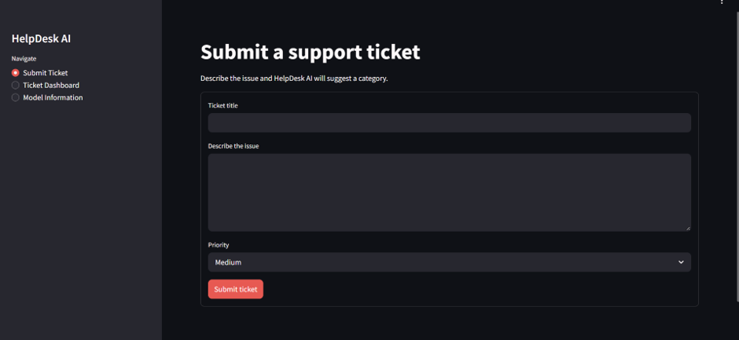
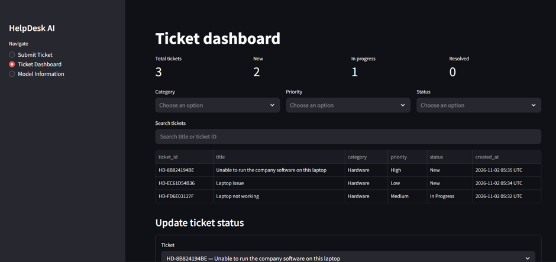
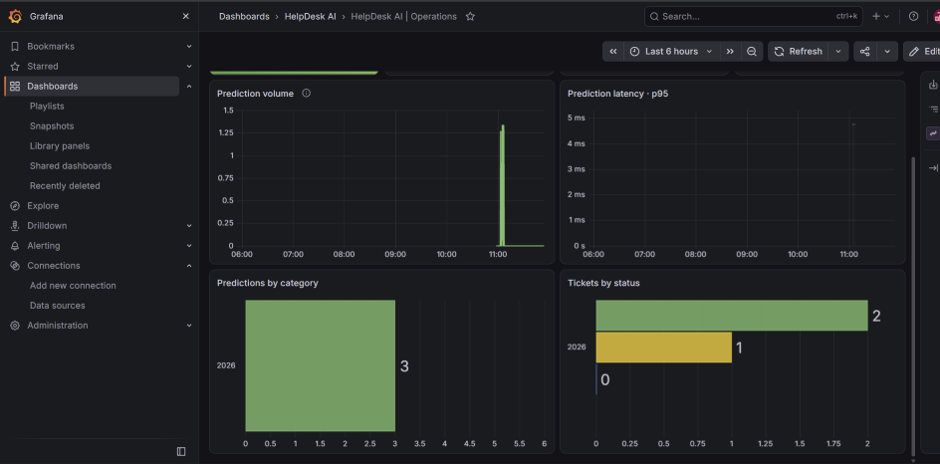
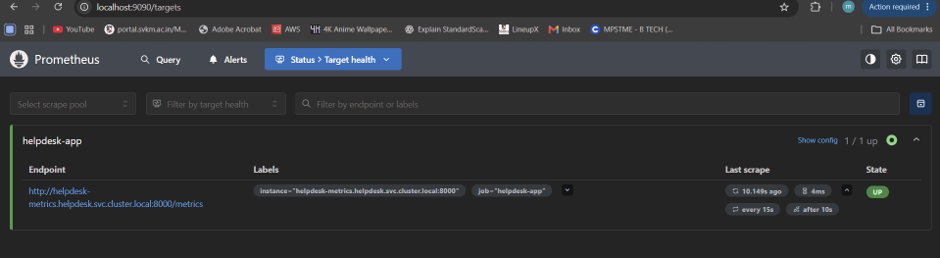

# HelpDesk AI

HelpDesk AI is a small ticketing application that demonstrates an end-to-end MLOps workflow. Users submit a title and issue description; a saved TF-IDF and Logistic Regression pipeline suggests one of eight issue categories and reports its confidence. The user selects priority, and SQLite stores the ticket and its status.

## Dataset and trained model

The workspace dataset is `data/all_tickets_processed_improved_v3.csv`. It is 14.6 MB and contains 47,837 rows with columns `Document` and `Topic_group`. The observed categories are Hardware, Access, Miscellaneous, HR Support, Purchase, Administrative rights, Storage, and Internal Project. No empty cells or exact duplicate rows were found in the initial audit.

The dataset source and license were not supplied with the workspace, and public copies with the same filename do not establish this file's provenance. The CSV is excluded from Git and Docker. Confirm its license with the original provider before redistribution. The trained model metadata records this limitation.

Create a Python 3.12 virtual environment, install dependencies, and train the model:

```powershell
python -m venv .venv
.\.venv\Scripts\Activate.ps1
python -m pip install -r requirements-dev.txt
python -m ml.train
```

Training validates the CSV columns, drops blank text/labels and duplicate text/label rows, then performs a seeded stratified 80/20 split. It saves the complete inference pipeline to `models/ticket_classifier.joblib` and holdout metrics, class distribution, classification report, and confusion matrix to `models/model_metadata.json`. The Streamlit app loads these files; it does not train at startup.

## Run locally

```powershell
.\.venv\Scripts\Activate.ps1
streamlit run app/streamlit_app.py
```

Open <http://localhost:8501>. The metrics endpoint is at <http://localhost:8000/metrics>. Tickets are stored at `data/tickets.db` by default; set `TICKET_DB_PATH` to change it.

## Tests

```powershell
python -m pytest -q
```

Tests cover the prediction interface, SQLite create/list/status operations, and submission logic. CI also loads the packaged model, runs a sample prediction, and builds the Docker image.

## Docker and monitoring

The image includes application code, dependencies, and the trained model. The raw CSV is excluded. To run the app plus Prometheus and Grafana:

```powershell
Copy-Item .env.example .env
# Edit .env and set a private local Grafana demo password.
docker compose up --build
```

Open Streamlit at <http://localhost:8501>, Prometheus at <http://localhost:9090>, and Grafana at <http://localhost:3000>. Grafana is provisioned with a Prometheus datasource and a dashboard for prediction totals, category counts, errors, latency, and ticket status counts. Metrics have bounded labels; ticket descriptions and IDs are never labels. Local Compose volumes preserve tickets and monitoring data across container restarts.

## GitHub Actions

`.github/workflows/ci.yml` runs on pushes and pull requests, installs dependencies, runs pytest, checks the packaged model, and builds the image without publishing it. `publish.yml` is manually started with a tag and uses the workflow's `GITHUB_TOKEN` to publish to GHCR. `deploy-aks.yml` is also manual and uses Azure OIDC; it expects GitHub environment `azure-demo` variables `AZURE_CLIENT_ID`, `AZURE_TENANT_ID`, `AZURE_SUBSCRIPTION_ID`, `AKS_RESOURCE_GROUP`, and `AKS_CLUSTER_NAME`. Configure a federated identity for that GitHub environment and grant only the Azure roles needed to retrieve AKS user credentials and deploy. The workflow has not been run against GitHub or Azure from this workspace.

For AKS, make the GHCR package public or create an `imagePullSecret` in the `helpdesk` namespace. Create Grafana credentials locally, then apply the example manifest only after replacing its placeholder:

```powershell
kubectl apply -f k8s/namespace.yaml
Copy-Item k8s/grafana-secret.yaml.example k8s/grafana-secret.yaml
# Edit admin-password, then apply. Do not commit the edited file.
kubectl apply -f k8s/grafana-secret.yaml
```

After applying the namespace and Secret, configure the application image in `k8s/app.yaml`, then apply `k8s/prometheus.yaml`, `k8s/grafana.yaml`, and `k8s/app.yaml` individually. Do not apply the example Secret file as-is. The app Service is the only LoadBalancer; Prometheus and Grafana are internal ClusterIP services. Access Grafana and Prometheus with `kubectl -n helpdesk port-forward svc/grafana 3000:3000` and `kubectl -n helpdesk port-forward svc/prometheus 9090:9090`.

The AKS app uses one replica and SQLite in `emptyDir`. Ticket records are lost when the pod is replaced. Prometheus and Grafana storage is also ephemeral, which is appropriate for a short demonstration.

## Terraform and Azure

`infra/terraform` provisions only a resource group and an AKS cluster on the Free control-plane tier, with one fixed worker node, no autoscaling, and no ACR or managed monitoring. Region and VM SKU are required inputs because availability and quota must be verified for the active subscription first. Copy `terraform.tfvars.example` to a local `.tfvars` file after filling values; state and `.tfvars` are ignored by Git.

Terraform commands for local review:

```powershell
terraform -chdir=infra/terraform fmt -check -recursive
terraform -chdir=infra/terraform init
terraform -chdir=infra/terraform validate
terraform -chdir=infra/terraform plan -var-file=demo.tfvars
```

The cluster, worker VM, managed disks, standard load balancer/public IP, and networking are billable even when the Kubernetes control plane uses the Free tier. Stop the cluster promptly after the presentation and delete it only after reviewing the bill and explicitly choosing cleanup. No Azure resource has been created by this project setup. Azure region, quota, and price checks are pending account access and should be completed before selecting the VM SKU or generating a final deployment plan.

### Azure preflight snapshot (2 Nov 2026)

Read-only checks found the enabled subscription `Azure for Students`, the `centralindia` region enabled with AKS versions available, and `Standard_B2s` listed in that region (2 vCPU, 4 GiB RAM). The subscription currently uses 0 of 6 regional vCPUs and 0 of 4 Standard BS family vCPUs, so the family quota can accommodate one B2s node. The Microsoft.Compute provider namespace was registered after explicit approval; no resource group, cluster, or other infrastructure was created.

Undiscounted USD retail baseline for one node in Central India: B2s VM $0.0448/hour; 32 GiB Standard SSD LRS OS disk (the tier for the configured 30 GiB disk) $2.64/month, prorated hourly; two Standard IPv4 public IPs at $0.005/hour each (AKS egress and the app LoadBalancer); AKS Free control plane $0. The first five Standard Load Balancer rules have no fixed hourly charge. This gives a baseline of about **$0.06/hour**, **$0.23 for 4 hours**, or **$1.40 for 24 hours**. Load balancer data processing and outbound bandwidth vary with traffic and are not included; taxes and any offer-specific adjustments are also excluded. Treat these as estimates, not a quote. Rates were checked with the [Azure Retail Prices API](https://learn.microsoft.com/rest/api/cost-management/retail-prices/azure-retail-prices); see Microsoft's pricing pages for [AKS](https://azure.microsoft.com/en-us/pricing/details/kubernetes-service/), [public IPs](https://azure.microsoft.com/en-in/pricing/details/ip-addresses/), [managed disks](https://azure.microsoft.com/en-in/pricing/details/managed-disks/), and [Load Balancer](https://azure.microsoft.com/en-in/pricing/details/load-balancer/).

## Presentation architecture

1. A user submits a ticket in Streamlit.
2. The app loads the saved scikit-learn pipeline and predicts a category with confidence; priority remains user-selected.
3. The ticket and status are saved to SQLite.
4. The app exports bounded-cardinality Prometheus metrics on port 8000. Prometheus scrapes the internal endpoint and Grafana displays the metrics.
5. Docker packages the app and model. GitHub Actions tests the code and builds the image; a manual workflow can publish it to GHCR.
6. Terraform defines the Azure resource group and AKS cluster. Kubernetes runs one app pod plus Prometheus and Grafana; the app is public through an Azure LoadBalancer, while monitoring is reached with port-forwarding.

## Cleanup

For a local Compose run, stop containers with `docker compose down`; add `-v` only if you also intend to remove the local SQLite and monitoring volumes. For Azure, use `terraform destroy` only after reviewing its plan and deciding to remove the demonstration resource group and cluster. The project workflows do not automatically destroy infrastructure.




