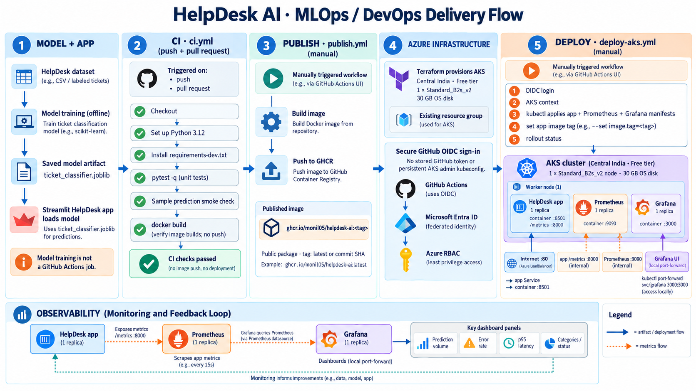
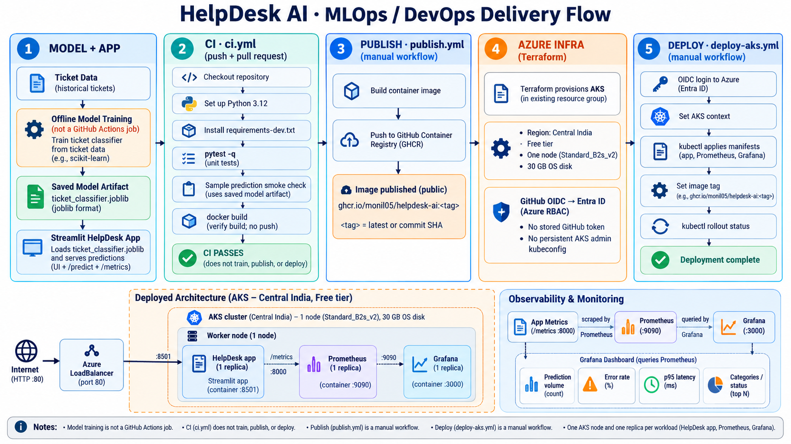

# HelpDesk AI

HelpDesk AI is an end-to-end MLOps demonstration: it combines a ticket-classification model with a Streamlit helpdesk application, persistent ticket management, automated checks, container packaging, and operational monitoring. The project also includes optional Azure Kubernetes Service (AKS) infrastructure and deployment workflows.





## What the project does

- Accepts support ticket titles, descriptions, and user-selected priorities.
- Predicts one of eight ticket categories with a trained scikit-learn model and displays its confidence.
- Stores tickets in SQLite and provides a searchable dashboard for reviewing tickets and updating their statuses.
- Exposes application and model metrics for Prometheus, with a preconfigured Grafana dashboard.
- Tests changes and builds a Docker image in GitHub Actions. Separate, manually triggered workflows publish the image and deploy it to AKS.

## How the flow works

The diagrams above show both the user-facing application and the delivery and deployment path:

1. **Prepare the model.** Offline training reads the labeled ticket dataset, cleans its text and labels, and trains a TF-IDF plus Logistic Regression pipeline. It saves the model and evaluation metadata under `models/`. Training is run explicitly; the application does not train at startup.
2. **Submit and classify a ticket.** A user enters a title and description in Streamlit and selects a priority. The app loads the saved model, predicts a category and confidence from the description, and saves the ticket with a `New` status to SQLite.
3. **Review tickets.** The dashboard shows ticket totals and statuses, supports category, priority, and status filters plus text search, and lets users update a ticket's status.
4. **Observe the application.** The app exposes prediction counts, category counts, errors, latency, and ticket-status gauges on its metrics endpoint. Prometheus scrapes those metrics; Grafana queries Prometheus and presents the provisioned dashboard.
5. **Validate and package changes.** On pushes and pull requests, GitHub Actions installs the development dependencies, runs the tests, checks a sample prediction using the packaged model, and builds the container image. This CI workflow does not train, publish, or deploy the model.
6. **Publish and deploy when requested.** A manually triggered workflow can publish a tagged image to GitHub Container Registry (GHCR). A separate manual workflow authenticates to Azure through GitHub OIDC, applies the Kubernetes manifests, updates the application image, and checks rollout status.
7. **Provision Azure infrastructure as needed.** Terraform defines an AKS cluster and a resource group. The Kubernetes manifests run the app, Prometheus, and Grafana; the app is exposed through a LoadBalancer, while the monitoring services remain internal.

## Requirements

- Python 3.12 for local development and model training
- Docker with the Docker Compose plugin for the containerized app and monitoring stack
- Optional for cloud deployment: Terraform, Azure CLI, `kubectl`, an Azure subscription, and GitHub Actions configuration for Azure OIDC

## Set up and run locally

From the repository root, create and activate a virtual environment, then install the development dependencies:

```powershell
python -m venv .venv
.\.venv\Scripts\Activate.ps1
python -m pip install -r requirements-dev.txt
```

The trained model is included in `models/`, so the app can be started without retraining:

```powershell
streamlit run app/streamlit_app.py
```

Open [http://localhost:8501](http://localhost:8501). The Prometheus metrics endpoint is [http://localhost:8000/metrics](http://localhost:8000/metrics). By default, local ticket data is stored in `data/tickets.db`; set `TICKET_DB_PATH` to use a different SQLite file.

### Retrain the model (optional)

The training dataset is `data/all_tickets_processed_improved_v3.csv`. Training requires the CSV to be present locally:

```powershell
python -m ml.train
```

The script validates the expected `Document` and `Topic_group` columns, removes blank and duplicate examples, makes a seeded stratified 80/20 train/test split, and saves the trained pipeline and evaluation metadata to `models/ticket_classifier.joblib` and `models/model_metadata.json`.

The current model uses TF-IDF unigrams and bigrams with Logistic Regression. Its recorded holdout accuracy is approximately 86.1%. The dataset's source and redistribution license have not been verified; confirm them with the original provider before sharing the CSV or derived artifacts.

## Run tests

```powershell
python -m pytest -q
```

The tests cover classification, ticket submission logic, and SQLite operations. CI also checks a sample prediction and builds the Docker image.

## Run with Docker Compose

Compose starts the application, Prometheus, and Grafana. Set local Grafana credentials before starting the stack:

```powershell
Copy-Item .env.example .env
# Edit .env and replace the example Grafana password.
docker compose up --build
```

Open the services at:

| Service | URL |
| --- | --- |
| HelpDesk AI | [http://localhost:8501](http://localhost:8501) |
| Prometheus | [http://localhost:9090](http://localhost:9090) |
| Grafana | [http://localhost:3000](http://localhost:3000) |
| App metrics | [http://localhost:8000/metrics](http://localhost:8000/metrics) |

Sign in to Grafana with the username and password configured in `.env`. Compose provisions the Prometheus datasource and HelpDesk AI dashboard automatically. Named Docker volumes preserve ticket data and monitoring data between container restarts.

Stop the stack with `docker compose down`. To also delete its stored ticket and monitoring data, use `docker compose down --volumes`.

## GitHub Actions

- **CI** (`.github/workflows/ci.yml`) runs on pushes and pull requests. It tests the project, validates the packaged model, and builds—but does not publish—the Docker image.
- **Publish** (`.github/workflows/publish.yml`) is manually triggered with an image tag and publishes the image to GHCR using `GITHUB_TOKEN`.
- **Deploy to AKS** (`.github/workflows/deploy-aks.yml`) is manually triggered with an existing image tag. Configure the `azure-demo` GitHub environment with `AZURE_CLIENT_ID`, `AZURE_TENANT_ID`, `AZURE_SUBSCRIPTION_ID`, `AKS_RESOURCE_GROUP`, and `AKS_CLUSTER_NAME`. The Azure identity must trust that GitHub environment through a federated credential and have the Azure permissions required to retrieve AKS credentials and deploy.

Before deploying, create the `helpdesk` namespace and the `grafana-credentials` Secret. For example:

```powershell
kubectl apply -f k8s/namespace.yaml
Copy-Item k8s/grafana-secret.yaml.example k8s/grafana-secret.yaml
# Edit the copied file with a private password; do not commit it.
kubectl apply -f k8s/grafana-secret.yaml
```

The deployment workflow applies the Prometheus, Grafana, and app manifests, then sets the app image and waits for rollout. Update the image reference in `k8s/app.yaml` as appropriate. If the GHCR package is private, configure an `imagePullSecret` in the `helpdesk` namespace. The app Service is the only LoadBalancer; access Grafana and Prometheus with:

```powershell
kubectl -n helpdesk port-forward svc/grafana 3000:3000
kubectl -n helpdesk port-forward svc/prometheus 9090:9090
```

The AKS demo uses one app replica and stores SQLite data in `emptyDir`, so tickets are lost when the pod is replaced. Prometheus and Grafana storage are also ephemeral.

## Optional Azure infrastructure with Terraform

`infra/terraform` defines an AKS cluster and resource group; it does not provision ACR or managed monitoring. Before creating infrastructure, verify the region, VM SKU availability, subscription quota, and current costs for your Azure subscription. AKS nodes, disks, networking, and public IP resources can incur charges.

Create a local `.tfvars` file from the example and fill in values verified for your subscription. The example requires a region, resource group name, cluster name, and VM SKU:

```powershell
Copy-Item infra/terraform/terraform.tfvars.example infra/terraform/local.tfvars
# Edit local.tfvars with values verified for your subscription.
terraform -chdir=infra/terraform fmt -check -recursive
terraform -chdir=infra/terraform init
terraform -chdir=infra/terraform validate
terraform -chdir=infra/terraform plan -var-file=local.tfvars
```

Review the plan and costs before applying. Terraform state and local `.tfvars` files are excluded from Git. To remove resources, run `terraform destroy` only after reviewing its plan and confirming that the resources should be deleted.
